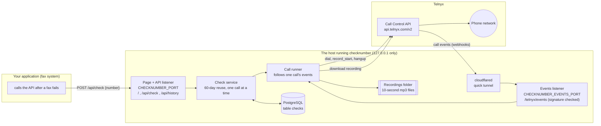
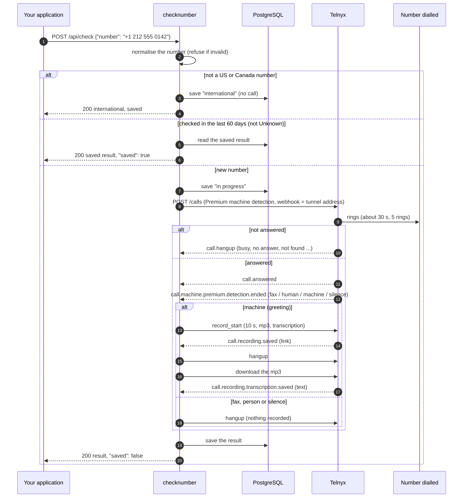

# validatecall (checknumber)

When a fax fails, the reason is often the number itself: it is a voice line, a disconnected
number, or nobody answers. **checknumber** dials the number once through
[Telnyx Call Control](https://developers.telnyx.com/docs/voice/programmable-voice) and reports
what answered:

| Code | Label | Meaning |
|---|---|---|
| `fax` | Fax | Telnyx heard fax tones |
| `voice_message` | Voice message | An answering machine or greeting; a recording of at most 10 seconds and its text are kept |
| `person_answered` | Person answered | A person answered; nothing is recorded |
| `picked_up` | Picked up | The line answered with silence (on real calls, fax lines often read this way) |
| `no_answer` | No answer | It rang about 5 times and nobody answered |
| `busy` | Busy | The line was busy |
| `disconnected` | Disconnected | The network says the number is not in service |
| `unallocated` | Unallocated | The number was never assigned |
| `disconnected_unallocated` | Disconnected / Unallocated | Used instead of the two above when they are set to be combined |
| `international` | International | Not a US or Canada number; saved and **never dialled** |
| `unknown` | Unknown | It could not tell; a reason is given, and the next request dials again |

Results are saved in PostgreSQL. A number checked in the last **60 days** is not dialled again:
the saved result comes back at once, so a number is never called twice for the same failure.

It is a Go service with two listeners, a test web page, and a small REST API for the system that
sends the faxes. Stage 1 runs on a Mac behind a Cloudflare quick tunnel; there is no public
address for the page or the API.

---

## How it works

### The parts



Only the **events** port is reached from outside, through the tunnel. The page and API port
answers on `127.0.0.1` only: anyone who could reach it could place paid calls.

### One check, step by step



Every event from Telnyx is checked against the account's public key (ed25519 signature
headers `telnyx-signature-ed25519` and `telnyx-timestamp`) before it is used. A check has a time
limit (120 s by default); when it runs out the call is hung up and the result is Unknown.

If the app stops during a call, the next start marks that check Unknown ("app restarted"), so
the next request dials the number again.

---

## The API

Full description: [`docs/API.md`](docs/API.md).

```bash
curl -s -m 180 -X POST "http://127.0.0.1:$CHECKNUMBER_PORT/api/check" \
  -H 'Content-Type: application/json' \
  -d '{"number":"+1 212 555 0142"}'
```

```json
{"number":"+12125550142","result_code":"busy","result_label":"Busy",
 "called_at":"2026-11-14T04:33:22Z","saved":false,"reason":"","text":""}
```

- `GET /api/history?number=%2B12125550142` lists the saved checks of one number.
- A new call takes up to about 2 minutes: set the client timeout to at least 180 seconds.
- Calls are placed one at a time; other requests wait their turn.
- When `CHECKNUMBER_API_KEY` is set, every `/api/` request needs
  `Authorization: Bearer <key>`.
- An empty or invalid number gets `400` with a message, and is neither saved nor dialled.

The test page at `http://127.0.0.1:$CHECKNUMBER_PORT/` does the same for one number by hand and
plays the recording of a voice message.

---

## What you need on the Telnyx side

Create these once in the [Telnyx portal](https://portal.telnyx.com):

1. **An account with outbound calling enabled** and a balance. Each check is a paid outbound
   call; a voice message also pays for Premium machine detection, a recording and a
   transcription.
2. **A phone number** on the account to call from. It is the caller ID of every check
   (`TELNYX_FROM_NUMBER`, `+1...`).
3. **A Call Control application** (Voice API application). Its id is `TELNYX_CONNECTION_ID`.
   - Webhook API version: **v2**.
   - Webhook URL: checknumber sends its own tunnel address with every dial (`webhook_url`), so
     the events of its calls reach it even though a quick tunnel gets a new address at every
     start. The application's own webhook URL is not used for these calls.
4. **An outbound voice profile assigned to that application.** Without it every dial is refused
   with error `10010` ("Connection has no Outbound Profile assigned", `D38`).
5. **An API key** (v2) from the portal → `TELNYX_API_KEY`. Secret.
6. **The account's public key** (base64) from the portal → `TELNYX_PUBLIC_KEY`. Used to check
   the signature of every event.

Telnyx features the app uses on each call (no portal switch needed; they are set in the
requests): Premium answering machine detection (`answering_machine_detection: premium`, 20 s),
recording (`record_start`: mp3, single channel, 10 s at most), and transcription
(`deepgram/nova-3`, `en-US`). Recording links are pre-signed links; the app downloads them
without the API key.

---

## Settings and the key file

The four Telnyx values are read from one local file, **`env.apikeys`** in the repository
folder. It is listed in [`.gitignore`](.gitignore) and must never be committed. The app refuses
to start if the file can be read by group or others, so set it to owner-only:

```bash
cp env.apikeys.example env.apikeys     # then fill in the four values
chmod 600 env.apikeys
```

One setting per line, `NAME:VALUE` or `NAME=VALUE`. Either name works:

| Setting | Short name in the file | What it is |
|---|---|---|
| `TELNYX_API_KEY` | `APIKEY` | API key (secret) |
| `TELNYX_PUBLIC_KEY` | `PUBLICKEY` | public key for event signatures, base64 |
| `TELNYX_CONNECTION_ID` | `APPLICATIONID` | Call Control application id |
| `TELNYX_FROM_NUMBER` | `FROMNUMBER` | number to call from, `+1...` |

An environment variable of the `TELNYX_` name wins over the file. The other settings are
environment variables:

| Setting | Required | What it is |
|---|---|---|
| `CHECKNUMBER_PORT` | yes | port of the page and API listener |
| `CHECKNUMBER_EVENTS_PORT` | yes | port of the events listener (the tunnel's target) |
| `PGDATABASE` | yes | database name; host, user and password come from the usual `PG*` variables |
| `CHECKNUMBER_RECORDINGS_DIR` | yes | existing folder for the recordings (keep it outside the repository) |
| `CHECKNUMBER_ENV_FILE` | no | path of the key file |
| `CHECKNUMBER_TUNNEL` | no | `cloudflared`: the app starts the quick tunnel itself |
| `CHECKNUMBER_PUBLIC_URL` | without `CHECKNUMBER_TUNNEL` | the tunnel's `https://` address when you start the tunnel yourself |
| `CHECKNUMBER_CHECK_LIMIT` | no | time limit of one check, default `120s` |
| `CHECKNUMBER_COMBINE_DISCONNECTED` | no | `true`: report "Disconnected / Unallocated" |
| `CHECKNUMBER_API_KEY` | no | shared key required on `/api/` requests (secret) |

A missing or wrong setting stops the app at once with a message that names it; no value is ever
printed.

---

## Running it

Requirements: Go 1.27, PostgreSQL 15, `cloudflared`. Built and run on macOS; the scripts use zsh.

```bash
createdb checknumber                          # the app creates its table itself
export PGDATABASE=checknumber
export CHECKNUMBER_PORT=5123 CHECKNUMBER_EVENTS_PORT=5124   # any two free ports
export CHECKNUMBER_ENV_FILE="$PWD/env.apikeys"
export CHECKNUMBER_RECORDINGS_DIR="$HOME/checknumber-recordings"; mkdir -p "$CHECKNUMBER_RECORDINGS_DIR"
export CHECKNUMBER_TUNNEL=cloudflared
go run ./cmd/checknumber
```

Then open `http://127.0.0.1:$CHECKNUMBER_PORT/`.

**Start at login (macOS):** `scripts/checknumber-autostart.sh install` builds `bin/checknumber`
and installs a LaunchAgent that starts the app at every login and restarts it if it stops.
`scripts/checknumber-autostart.sh remove` undoes it. Log: `~/Library/Logs/checknumber/checknumber.log`.
The start script takes the two ports from a port registry program (`PORT_REGISTRY`, default
`~/bin/port_registry.py`); set `CHECKNUMBER_PORT` and `CHECKNUMBER_EVENTS_PORT` in `~/.zshrc`
instead if you do not use one.

Step-by-step guide, all settings and the manual test calls: [`docs/RUNNING.md`](docs/RUNNING.md).

### Tests

```bash
go build ./... && go vet ./... && go test ./... -count=1
```

The tests need a local PostgreSQL with a separate database, `checknumber_test`
(`createdb checknumber_test`); each test uses a fresh schema and drops it. They never place a real call, contact Telnyx or start a tunnel.

---

## Key files

| File | What it does |
|---|---|
| [`cmd/checknumber/main.go`](cmd/checknumber/main.go) | Start-up: reads the settings, opens the database, starts the tunnel and both listeners |
| [`internal/config/config.go`](internal/config/config.go) | Reads and checks every setting and the key file `env.apikeys` |
| [`internal/check/service.go`](internal/check/service.go) | One check: number rules, 60-day reuse, International, one call at a time |
| [`internal/check/runner.go`](internal/check/runner.go) | Follows one call's events from dial to result, recording and text |
| [`internal/telnyx/client.go`](internal/telnyx/client.go) | Telnyx Call Control commands: dial, record, hang up, download |
| [`internal/telnyx/event.go`](internal/telnyx/event.go) | Parses Telnyx events and checks their ed25519 signature |
| [`internal/httpapi/api.go`](internal/httpapi/api.go) | `/api/check` and `/api/history` |
| [`internal/httpapi/events.go`](internal/httpapi/events.go) | `/telnyx/events`, the webhook receiver |
| [`internal/httpapi/auth.go`](internal/httpapi/auth.go) | The optional shared API key |
| [`internal/result/result.go`](internal/result/result.go) | The result codes and labels, and how Telnyx answers map to them |
| [`internal/phone/phone.go`](internal/phone/phone.go) | US and Canada number rules, International numbers |
| [`internal/store/store.go`](internal/store/store.go), [`schema.sql`](internal/store/schema.sql) | PostgreSQL: the `checks` table |
| [`internal/tunnel/tunnel.go`](internal/tunnel/tunnel.go) | Starts `cloudflared` and reads the tunnel address |
| [`internal/web/page.go`](internal/web/page.go), [`page.html`](internal/web/page.html) | The test page |
| [`scripts/checknumber-run.sh`](scripts/checknumber-run.sh), [`scripts/checknumber-autostart.sh`](scripts/checknumber-autostart.sh) | Start script and the macOS LaunchAgent |
| `env.apikeys` | **Your** Telnyx keys; git-ignored, never committed ([`env.apikeys.example`](env.apikeys.example) shows the form) |

---

## Known limits

- Premium detection often reports `silence` on real fax lines, so a fax line may read
  "Picked up" instead of "Fax".
- The recording starts after detection says "machine", 4 to 5 seconds after the answer, so the
  first words of a greeting are missing.
- The page and API answer on `127.0.0.1` only; a caller on another machine cannot reach them yet.
